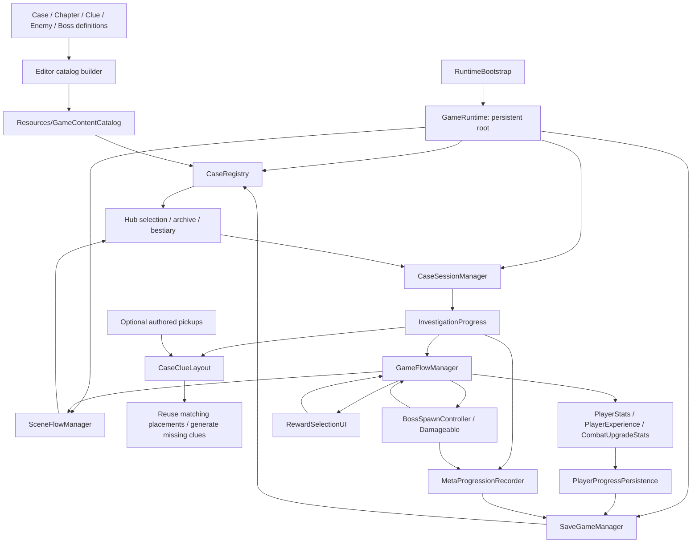
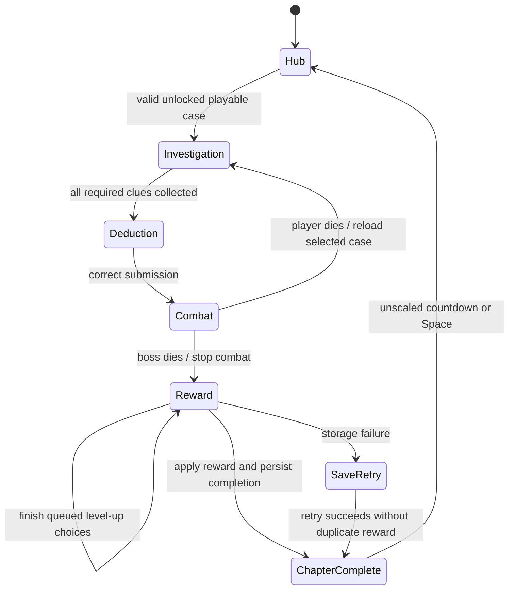

# Architecture

## Phase Status

Phase 6 integrates the existing Room 304 prototype into a multi-case framework.
Source and generated assets must pass the gates in PhaseReport before release.
No second chapter, new boss, new weapon, final story, or art is added.

## System Overview

## Manager Overview

| Owner | Responsibility |
| --- | --- |
| RuntimeBootstrap / GameRuntime | Create one persistent root; initialize save before registry, session, and scene flow |
| SaveGameManager | JSON load, atomic save, version protection, focused mutations, IO diagnostics |
| CaseRegistry | Validated definition indices; derive case states and start eligibility |
| CaseSessionManager | Selected case for the active run; survives scene reload |
| SceneFlowManager | Hub/shared-scene loading and timeScale reset |
| InvestigationProgress | Transient collected clues and deduction success for the active definition |
| GameFlowManager | Local investigation-to-completion transitions; durable case completion |
| PlayerProgressPersistence | Restore permanent modifiers/XP once, capture relevant mutations |
| MetaProgressionRecorder | Idempotent clue/enemy/boss discovery writes |
| CombatGameManager | Failure reload while retaining selected case and permanent progress |

UI presents state; it does not decide unlock rules. Boss reward application and completion
persistence belong to GameFlowManager. Generic RewardSelectionUI only reports a choice.

## State Machines

GameFlowState remains Investigation, Deduction, Combat, Reward, ChapterComplete.
Hub is a scene, not an added local enum member. SaveRetry is an error presentation while
remaining in Reward; it is not a persisted state. CaseState is separately derived as
Locked, Available, or Completed. Completed cases can replay; placeholders can unlock
without becoming playable.

## Scene Flow

Build order: 0 Hub, 1 CombatSandbox. GameRuntime uses DontDestroyOnLoad.
Selecting a case establishes a session before loading the shared scene.
InvestigationProgress.Awake reads the session; its serialized definition is only a
direct-scene fallback. CaseClueLayout.Start reuses matching authored pickups and
creates missing pickups from that definition.
Completion returns to Hub and ends the session. Failure reload retains the session.

The generator seeds Room 304 and one metadata-only placeholder in Chapter_01.
Active Phase 6 controllers contain no Room304 identifiers or story constants.
The deprecated `Room304GameStateController` is a passive serialization shell with
the historical script GUID and five private serialized references. It keeps untouched
legacy scenes free of Missing Script without restoring a competing state machine.
It does not make a legacy Room scene a playable Phase 6 entry point; start from Hub.

## Data Flow And Lifetime

| Data | Lifetime / owner |
| --- | --- |
| Content names, IDs, clue relations, reward pools | ScriptableObjects, read-only at runtime |
| Level, XP, pending upgrade choices and permanent modifiers | SaveGameData.PlayerProgress |
| Completed cases, discoveries and unlocks | Sets of stable IDs in SaveGameData |
| Current case selection | CaseSessionManager, across scene changes but not application restarts |
| Current HP, enemies, projectiles, collected run clues | Scene components, reset per run |
| Locked/Available/Completed | Derived from definitions and completion IDs; not redundantly saved |

Restore occurs after Awake so Damageable cannot overwrite restored maximum health.
Current HP is not a permanent upgrade; entering a fresh run restores health.
Health changes refresh HUD but do not write the save.
Upgrade selection batches its stat effect, consumed choice, and any unlock into a
single save snapshot. An interrupted run restores unspent choices after all Awake
callbacks, rather than silently granting a level without its upgrade.

## Dependencies And Boundaries

- LostCity.Meta.Core: no UnityEngine references; DTOs, sanitization, progression rules.
- LostCity.Meta.Persistence: Core + UnityEngine; JSON/filesystem adapter.
- Assembly-CSharp: runtime services, definition assets, combat and UI.
- Assembly-CSharp-Editor: generators, postprocessor and validation utilities.
- Tests reference Core/Persistence directly and predefined assemblies through reflection.
- Existing packages: Unity Input System, Unity UI, 2D physics, Test Framework. No new package.

## Extension Relationships

Catalog discovery is editor-only and automatically follows definition assets. Duplicate
IDs exclude all ambiguous entries. Chapter ordering/prerequisites drive progression;
unassigned cases remain discoverable. A valid playable case requires clues, deduction
text, registered boss with Damageable, and applicable rewards.

CaseClueLayout removes the former three-clue scene assumption. The layout is a temporary
graybox arrangement, not a procedural mystery generator. Its optional authored pickup
list retains existing scene placements during migration; only generated clones are
destroyed on rebuild. Reward validation and presentation
share GetCompletionRewards, avoiding a startable case with an empty reward screen.

## Failure Boundaries And Debt

Save writes use same-directory temporary files and atomic replacement with a previous
backup. Corruption is preserved; future schemas are read-only. IO errors remain visible
and retryable, not silently reported as completion. One local writer is supported.

Native save/reload and generated references are distinct from gameplay verification.
The user owns normal UI, combat feel, and full-loop Play Mode acceptance. The large
sandbox generator, prototype font fallback, and simple deduction model remain deliberate debt.
