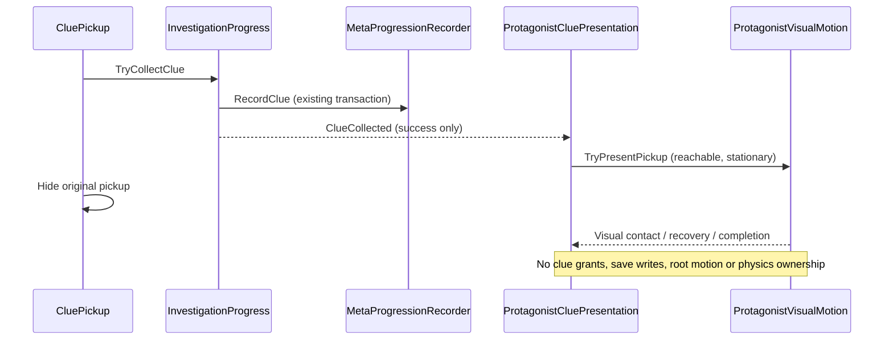
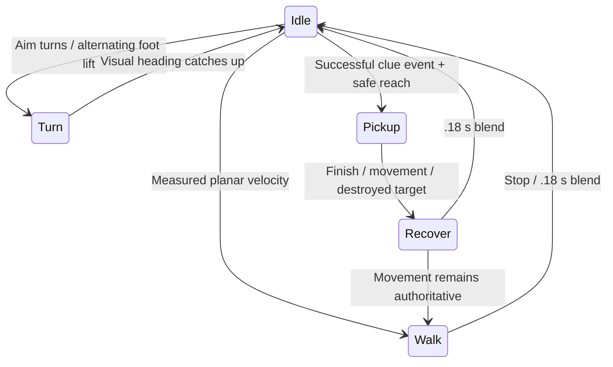

# Protagonist Motion Implementation

## Scope And Ownership

The approved motion brief is `Design/2026-10-17-character-motion-v1/`.
The existing first-pass mesh is retained and given an editable Blender armature,
normalized skin weights and a Unity procedural bone driver. This is not a new
combat controller, an AnimationClip library, or final character art.

Affected systems: protagonist source/export, independent visual prefab, Room304Greybox
visual integration, and presentation of the existing successful clue-collection event.
PlayerMotor, PlayerAim, the old Player prefab, Room scene, progression transactions,
and save schema remain authoritative and are not redesigned.

## Implementation And Documentation Plan

1. Correct model export axes; add pelvis, spine/chest, neck/head, two-segment limbs,
   hands/fingers, feet/toes and bag bones with deforming skin.
2. Replace whole-limb swinging with in-place procedural skeletal motion: stable idle,
   measured-velocity gait, constrained look, stepped visual turns and left-hand pickup.
3. Observe successful collection after its existing data commit. A visual proxy may
   survive the original pickup being hidden, but cannot grant clues or write saves.
4. Update only the sample's recognized character subtree and clue presentation anchors.
5. Validate actual imported bones/weights, sampled poses, pause/cancel behavior,
   save/reopen references, existing regressions and offline rendered sequences.
6. Synchronize CharacterVisual API, architecture/event diagrams, onboarding, sample
   guide, folder map, roadmap, phase report, verification commands and README.

## Data And Visual Timing

An unreachable/unsupported pose is skipped; data success is not undone. Player
movement cancels presentation rather than locking input. A destroyed target cancels
the visual; deactivation after successful collection is expected. Scaled-time pause
freezes the pose and resumes it without repeating collection. No animation event
participates in progression or save correctness.

## Verification Status

### Reported Walking Regression

The user reported movement without leg/arm animation after the first delivery.
Native Unity 2022.3.32f1 reproduction confirmed the cause: each `.02 s` physics
step after `Rigidbody2D.MovePosition` moved the player `.064 m`, while
`Rigidbody2D.velocity` stayed `(0,0)` before, during and after the step. Both None
and Interpolate configurations produced this result. The old LateUpdate read only
that velocity, so locomotion blend remained zero. Mouse-facing still worked because
PlayerAim independently rotates AimRoot.

Existing pose tests injected velocity directly and did not prove the
`PlayerMotor.MovePosition -> movement observation -> ProtagonistVisualMotion`
connection. The fix must derive observed speed from completed physical displacement,
not desired input. The implemented driver samples body.position in FixedUpdate,
computes the previous completed step's displacement / fixedDeltaTime, and caches
the result for LateUpdate. Frames without a physics tick retain the sample; a
blocked body contributes no motion. The observation adds one fixed-step latency
(20 ms at the current setting). Enable/disable/direct reparent reset the baseline.
Pickup gating now also checks observed movement before the pose blend catches up.
PlayerMotor, PlayerAim, assets and collection/save ownership are unchanged.

The new native `ProtagonistMovementObservationTests` fixture passes **10/10**:
interpolation on/off, stop, aim-only turn, wall blocking, pause, render/fixed cadence,
disable/reparent baselines and pickup gating/cancellation. It uses a disposable
Editor preview scene and asserts its physics scene is not the user's default
scene. No Play Mode or input is started. The full original-project native suite
passes **186/186**, 0 failed/skipped (2026-10-17 08:32:26 UTC).

The 176-test result below is the historical pose/event baseline, not proof of the
reported walking path. [PhaseReport](PhaseReport.md) records the correction and
evidence. This patch requires no scene or prefab regeneration.

Native import and saved-reference acceptance pass in the original Unity project.
The imported model contains 25 bones, 94 skinned renderers, 8,707 split vertices,
13,584 triangles, 19 used materials and 3,048 blended vertices. The Blender source
has 7,051 vertices and 13,692 evaluated triangles; these are different measurement
stages, not interchangeable budgets. Height is approximately 1.77 m.

Actual bone sampling checks grounded soles, alternating support and opposite arm
swing, cycle continuity, smaller head bob than pelvis, 25/12-degree gaze limits,
fixed limb lengths, paused poses, movement cancellation and return to rest. Native
acceptance reopens the saved prefab/scene, checks canonical axes and validates a
collision-clear, reachable approach to each of the three actual clue anchors.
The pre-regression-fix native suite passed **176/176**, including 27 motion tests and 18 actual
collection/event/save integration tests. See the phase report for the executed
matrix, failed-fixture correction and evidence paths.

Offline Unity outputs are committed in [Previews/CharacterMotion](Previews/CharacterMotion/README.md).
Each sequence samples the production bone evaluator and bakes the posed skin before
rendering, avoiding cached GPU poses in synchronous Editor rendering. Nonblank,
missing-shader and distinct-frame checks pass. These are not Play Mode recordings.

## Presentation States

These are derived visual states, not additions to GameFlowManager:

## Manual Acceptance

Open `Assets/_Project/Scenes/Room304Greybox.unity` in the original project. No
generation is needed. Do not rebuild CombatSandbox to test this visual change.

1. Walk forward, backward and sideways with WASD/arrows while moving mouse aim;
   the gameplay root remains on XY and the model does not move the controller.
2. Start/stop and turn approximately 90/180 degrees. Check gait blending, stepped
   turns, arm/bag clearance and feet at the actual camera scale. Releasing movement
   or continuing to press against a solid wall should settle to idle. Mouse-only
   turning may show the existing turning steps, but must not start the forward gait.
3. Stand still facing a reachable table edge with the object in front of the left
   hand, then collect with E. The clue commits once; the left hand reaches, touches
   and retracts. The three clue visuals have been moved toward accessible edges,
   but their trigger roots and IDs are unchanged.
4. Collect while moving or from an unreachable angle. Collection still succeeds;
   presentation intentionally skips rather than stretching an arm or locking input.
5. During a reach, move away, rotate abruptly or pause/resume. Confirm recovery and
   no repeated clue, lingering visual copy or unexpected movement restriction.
6. Check J/journal, return to Hub, relaunch and existing combat separately. The
   independent sample does not include deduction, weapons or the boss loop.

No normal-input gameplay, game-feel, overlay UI or quit/relaunch acceptance is
claimed by the editor/offline checks. The user owns those tests.

## Limits And Follow-Up

- Procedural Generic skeleton, not AnimationClips or a retargetable Humanoid rig.
- Flat-plane in-place gait; no terrain IK, path-based foot locking or collision
  avoidance. Sudden aim reversals, strafe/backpedal feel and actual-speed cadence
  still need user testing. At 3.2 m/s and 1.25 m per cycle, cadence is 2.56 cycles/s;
  the preview deliberately shows one cycle per second for inspection.
- Empty-hand table reach only; the restrained armed pose is an opt-in safeguard,
  not a pistol animation set and is not attached to the old combat Player prefab.
- Grouped fingers approximate contact; no exact finger grip, facial animation,
  corrective shapes or cloth simulation. Pocket/collar/strap attachment and shoulder
  deformation remain visibly coarse and require a later, scoped art iteration.
- 94 skin renderers, readable meshes and offscreen skin updates favor inspection
  over shipping performance. Consolidation/bounds tuning is deferred, not hidden.
- Pickup proxies support static mesh renderers with ordinary TRS transforms, not
  sheared hierarchies, skinned clues, physics or persistent carried inventory.
