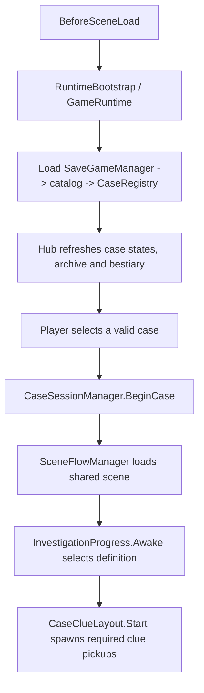
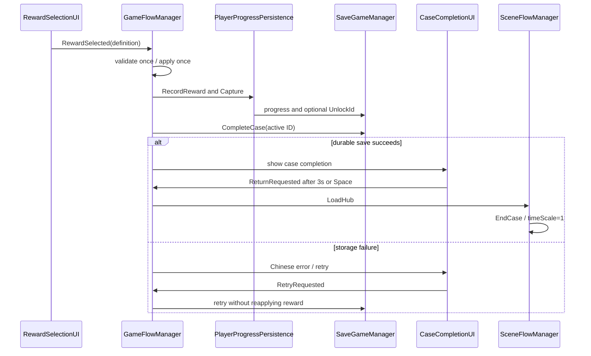

# Event Flow

All chains below separate triggers, owning systems, and results. API details live in Docs/API.
This describes the Phase 6 implementation; actual verification is tracked in PhaseReport.

## Startup And Case Selection



## Clue Pickup And Journal Update

```text
Player presses E near pickup
  -> CluePickup / InvestigationProgress.TryCollectClue
  -> Add transient clue and MetaProgressionRecorder.RecordClue
  -> SaveGameManager.DiscoverClue: autosave if new
  -> ClueCollected: EvidenceJournal refreshes
  -> AllRequiredCluesCollected: GameFlowManager enters Deduction
```

Repeated pickup IDs do not create repeated archive entries or save writes.
Unrelated clues are rejected. Archive history does not auto-collect run clues on replay.

## Deduction And Truth Reconstruction

```text
Submit Deduction
  -> DeductionBoard validates selected configured clues
  -> InvestigationProgress.MarkCaseSolved
  -> CaseSolved
  -> GameFlowManager disables deduction, enables combat, requests boss spawn
  -> Truth text / prompt is read from the active CaseDefinition
```

## Enemy And Boss Encounters

```text
Enemy OnEnable / BossSpawnController.SpawnBoss
  -> MetaProgressionRecorder.RecordEnemy / RecordBoss
  -> SaveGameManager.EncounterEnemy / EncounterBoss
  -> Stable ID stored once; bestiary can reveal registered content
```

BossSpawned also binds its Damageable.Died event in GameFlowManager.
The boss XP dropper is disabled for this flow; XP is paid once directly on death.

## Boss Death

```text
Damageable.Died
  -> GameFlowManager enters Reward and stops combat
  -> Stop EnemySpawner, disable weapons, clear enemies/projectiles/loose XP
  -> PlayerExperience receives boss XP; further XP intake stops
  -> Resolve pending level-up choices
  -> Show filtered CaseDefinition.GetCompletionRewards
```

## Level Up

```text
XP pickup or boss XP settlement
  -> PlayerExperience updates level/XP/threshold and upgrade queue
  -> ProgressChanged -> PlayerProgressPersistence capture
  -> UpgradeSelectionController.Show pauses gameplay
  -> Choice modifies PlayerStats / CombatUpgradeStats
  -> PermanentProgressChanged -> capture/save
  -> Clear old choice callback before invoking it
  -> Show next queued choice, or notify GameFlowManager that rewards may begin
```

Clearing callback state before invoking it prevents a synchronous next-choice Show
from being erased. UI input continues when timeScale is zero.
The player persistence adapter defers writes during this mutation, then commits
the stat/unlock effect and decremented PendingUpgradeChoices together. Restoring
a player resumes saved pending choices after initialization.

## Reward, Completion And Return



ChapterComplete is retained as a GameFlowState identifier; progression to the next
case is derived on Hub rather than a hardcoded next-chapter screen.

## Failure Reload

```text
Player Damageable.Died
  -> PlayerDeathHandler disables control and XP intake
  -> CombatGameManager captures progress
  -> On success: unscaled delay, reset timeScale, reload current scene path
  -> CaseSession remains; player stats restore and run clue state starts fresh
  -> On save failure: keep current scene and expose retry
```

## UI Refresh And Storage Recovery

SaveGameManager.DataChanged refreshes currently visible Hub views. Hidden archive and
bestiary panels refresh on enable; disable removes subscriptions. Hub blocks entry when
storage is read-only or dirty. Explicit 重试存档 invokes Reload for read-only storage,
otherwise SaveNow, then refreshes eligibility. No UI retry deletes or bypasses a
future-version save.
