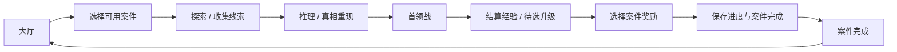

# Gameplay Loop

## Core Loop

## Investigation And Deduction

The active CaseDefinition supplies all clues, question, answer, boss, and completion
rewards. The shared scene places every required clue using CaseClueLayout.
E collects a nearby clue, J opens the journal, Tab opens deduction.
Clues remain handcrafted; the current deduction prototype validates a configured clue
set, not free-form natural-language hypotheses.

Each collection updates transient investigation state and the permanent archive.
A failed/replayed investigation starts fresh locally while previous discoveries remain
reviewable from Hub. Previously discovered clues do not auto-solve a replay.

## Player Progression

XP levels offer one upgrade choice per gained level. Attack, maximum health, fire rate,
crit, dodge, and drone count modifiers persist through the player persistence adapter.
Level, partial XP, next threshold, and unspent upgrade choices persist. Current HP and spawned pickups are not saves.
A new run starts at restored maximum health.
An upgrade choice and its stat/unlock effect are saved together; quitting between
level-up and selection restores the choice on the next run without duplicating an effect.

Permanent unlock rewards record stable UnlockIds. They do not invent a general inventory.
Normal damage/healing refreshes HUD without an autosave on every hit.

## Boss Progression

Correct deduction starts combat and spawns the case boss. Encountering it updates the
bestiary. Boss death stops spawning and player fire, removes remaining enemies,
projectiles, and loose XP pickups. Boss XP is awarded directly once at death so a
delayed pickup cannot reopen upgrade UI over the victory screen.

Pending level-up choices finish before the case reward is shown. Applying the chosen
case reward, capturing player progress, and recording case completion precede the
completion screen. Save retries must not apply the reward twice.

## Chapter Progression

Registry derives Locked, Available, and Completed from chapter prerequisites and ordered
predecessor completion. Valid unassigned cases appear separately. Completed cases can
be investigated again. Room 304 completion unlocks the next-case placeholder, but its
IsPlayable=false keeps its start button disabled. This is not Chapter 2 content.

## Failure States

- Incorrect/incomplete deduction: remain in investigation/deduction; no boss.
- Player death: capture permanent progress, reset timeScale, reload the selected case.
- Storage failure: keep dirty progress in memory, show Chinese status/retry; do not claim
  durable case completion or unload pending progress.
- Future save schema: read-only, no destructive fallback; Hub blocks starting.
- Missing/ambiguous content: refuse starting with a configuration reason.
- Scene load failure: restore timeScale and report failure; completion offers retry.

## Victory States

Boss Defeated is the transition into Reward, not final completion. ChapterComplete is
the retained local enum name for a completed case. The UI says 案件完成 and returns to
Hub after three unscaled seconds, or Space immediately. Archive/bestiary and case states
refresh from persistent services without restarting the game.

## Verification Boundary

See PhaseReport for actual command results. EditMode covers rules, native save data,
UI/controller contracts and generated references. It is not proof of rendering, clicking,
combat feel, or real scene-transition gameplay; those manual checks belong to the user.
