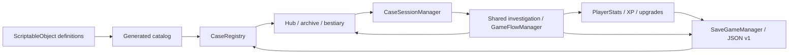

# Lost City | 迷城

**Mystery & Deduction + Lightweight Roguelike Action**

Unity 2022.3 LTS · C# · Unity Input System · PC prototype

## Project Overview

Lost City combines exploration, handcrafted deduction, and approachable top-down combat inside fragmented memory spaces. Players reconstruct a hidden truth, confront its manifestation, and carry discoveries back to a shared hub. Random encounters must not randomize the underlying truth.

The current content is **Room 304**, a graybox architecture prototype, not final story or art. There is no Chapter 2, multiplayer, live service, or procedural mystery generator.

## Current Development Phase

**Phase 6: Meta Framework implemented; manual acceptance pending.** Phase 6 adds case selection, chapter progression, local saves, archives, bestiary, and return to Hub. Unity EditMode tests pass **83/83**, and generated scenes pass saved-reference validation. These are not a played end-to-end run: see [PhaseReport](Docs/PhaseReport.md).

## Current Playable Features

The established sandbox includes movement, mouse aiming, a manual pistol, an automatic memory orb, four enemy archetypes, The Warden, health bars, HUD/minimap, XP collection, levels, and reward choices. Room 304 supports clue pickups, a journal, deduction, truth reconstruction, and a boss-to-reward flow.

Phase 6 includes automatic content indexing, locked/available/completed case states, Chinese Hub/archive/bestiary views, versioned JSON persistence, and case-driven clue placement. Levels, upgrades and unspent choices persist; a completed case returns to Hub automatically. Manual gameplay acceptance remains pending.

## Core Gameplay Loop

```text
大厅 -> 选择案件 -> 探索 -> 收集线索 -> 推理 -> Boss战
  ^                                           |
  +------ 案件完成 <- 保存进度 <- 选择奖励 <-----+
```

## Controls

| Action | Input |
| --- | --- |
| Move | WASD / Arrow Keys |
| Aim / Fire | Mouse position / Left Mouse Button |
| Investigate clue | E |
| Journal / Deduction | J / Tab |
| Select case, upgrade, or reward | UI buttons |
| Return after completion | Automatic countdown; Space skips wait |
| Debug: unlock clues / spawn boss / kill boss | F1 / F2 / F3 |

## Getting Started

1. Clone the repository and open it in **Unity 2022.3.32f1** through Unity Hub.
2. Activate an Editor license; let Unity resolve `Packages/manifest.json`.
3. Keep `.meta` files with assets. Do not commit `Library`, `Temp`, or local saves.

## How To Run

1. Save scene changes. Generation overwrites seeded sandbox assets.
2. Run `Tools > Lost City > Create Combat Sandbox`.
3. Run `Tools > Lost City > Validate Meta Framework`.
4. Open `Assets/_Project/Scenes/Hub.unity`, press Play, and select `304号病房`.

Build order is Hub, then CombatSandbox. The shared scene retains Room 304 as a direct-debug fallback; a Hub-selected session takes precedence. The next-case placeholder is metadata only and cannot be played.

See [Verification](Tools/Verification/README.md) for tests and batch commands. Gameplay, clicking, and balance checks belong to the developer; Computer Use is not part of verification.

## Latest Architecture Diagram



## Folder Structure Summary

```text
Assets/_Project/
  Code/CombatSandbox/    Combat, investigation, UI, editor generation
  Code/Meta/             Rules, persistence, catalog, runtime, Hub UI
  Tests/EditMode/Meta/   Core and Unity-facing tests
  Prefabs/CombatSandbox/ Generated graybox prefabs
  Scenes/               Hub and shared CombatSandbox
  ScriptableObjects/    Seed content and chapter metadata
  Resources/            Generated GameContentCatalog
  Settings/Input/       Input Actions and references
Docs/                   Architecture, APIs, onboarding, phase report
Tools/Verification/     Managed checks and native verification commands
```

Details: [FolderStructure](Docs/FolderStructure.md).

## Collaboration Workflow

Read [DeveloperOnboarding](Docs/DeveloperOnboarding.md) and the [Development Constitution](Docs/DevelopmentConstitution.md). Keep work bounded; each commit report identifies behavior, actual tests, gaps, and documentation changes. Preserve collaborators' local changes.

## Git Branch Strategy

Use `codex/<topic>` for agent work and focused branches for other contributions. The integration branch is currently `master`. Merge only after review and relevant verification; commit code, assets, and matching metadata together.

## Team Roles

Solo-developer-first, with collaboration areas in Unity/gameplay engineering, investigation design, QA/tooling, and documentation. These are potential ownership areas, not claims about an existing team. Art/audio production follows gameplay validation.

## Current Roadmap

1. Complete manual Phase 6 gameplay acceptance after the passing automated checks.
2. Validate actual return flow, replay, interruptions, persistence, and input regressions.
3. Prove new definitions work without case-specific runtime edits.
4. Consider new content only after these gates pass.

See [Roadmap](Docs/Roadmap.md).

## Future Vision

Richer exploration and emotionally grounded mysteries built on a maintainable data-driven foundation. No additional chapter content is currently in scope.

## Known Issues

- Actual runtime scene transitions and the normal played loop still need manual verification.
- Regenerate seed resources after future serialized-field or generator changes.
- Managed compilation cannot verify native serialization, lifecycle, UI, or scene loading.
- Chinese graybox text uses installed CJK font fallback, not guaranteed shipping font coverage.
- Saves assume one local writer, not cloud sync or concurrent game instances.
- Narrative, visuals, deduction mechanics, and balance remain prototype quality.

## Documentation

[Index](Docs/README.md) · [Architecture](Docs/Architecture.md) · [Gameplay Loop](Docs/GameplayLoop.md) · [Event Flow](Docs/EventFlow.md) · [Phase Report](Docs/PhaseReport.md)

## License

License placeholder. No project license has been selected; public source access does not itself grant redistribution rights.
