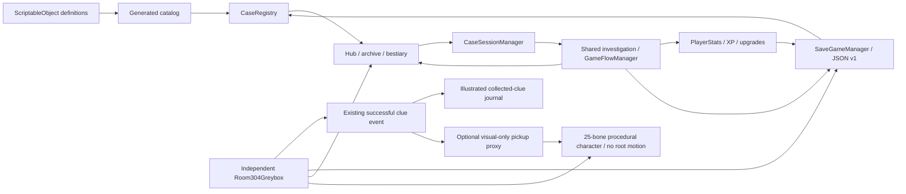

# Lost City | 迷城

**Mystery & Deduction + Lightweight Roguelike Action**

Unity 2022.3 LTS · C# · Unity Input System · PC prototype

## Project Overview

Lost City combines exploration, handcrafted deduction, and approachable top-down combat inside fragmented memory spaces. Players reconstruct a hidden truth, confront its manifestation, and carry discoveries back to a shared hub. Random encounters must not randomize the underlying truth.

The current content is **Room 304**, a graybox architecture prototype, not final story or art. There is no Chapter 2, multiplayer, live service, or procedural mystery generator.

## Current Development Phase

**Phase 6 integrated; Room 304 spatial/character sample ready for manual acceptance.** Phase 6
adds case selection, progression, saves, archives, bestiary and return to Hub.
The latest Unity EditMode suite passes **176/176** (131 existing + 45 character tests).
Migrated scenes and the new sample pass saved-reference validation; sample offline
world renders pass at three aspect ratios. None is a played end-to-end run:
see [PhaseReport](Docs/PhaseReport.md).

## Current Playable Features

The established sandbox includes movement, mouse aiming, a manual pistol, an automatic memory orb, four enemy archetypes, The Warden, health bars, HUD/minimap, XP collection, levels, and reward choices. Room 304 supports clue pickups, a journal, deduction, truth reconstruction, and a boss-to-reward flow.

Phase 6 includes automatic content indexing, locked/available/completed case states, Chinese Hub/archive/bestiary views, versioned JSON persistence, and case-driven clue placement. Levels, upgrades and unspent choices persist; a completed case returns to Hub automatically. Manual gameplay acceptance remains pending.

An independent **Room 304 2.5D graybox** adds a hospital room and short corridor,
fixed oblique camera, solid 2D footprints and a collected-clue illustration journal.
It reuses the original three clues and supplied UI images. It has no combat,
deduction or completion flow and does not replace the full sandbox.

The approved protagonist follow-up adds an editable Blender model, a 25-bone skin
rig and procedural idle/walk/turn/look/left-hand pickup presentation to that sample.
It retains 2D physics and the existing clue/save transaction. Native skin, pose,
saved-reference and event/save regression checks pass; see
[CharacterMotion](Docs/CharacterMotion.md) and the [actual previews](Docs/Previews/CharacterMotion/README.md)
for evidence and remaining manual checks. No combat animation library is claimed.

## Core Gameplay Loop

```text
大厅 -> 选择案件 -> 探索 -> 收集线索 -> 推理 -> Boss战
  ^                                           |
  +------ 案件完成 <- 保存进度 <- 选择奖励 <-----+
```

## Controls

| Action | Input |
| --- | --- |
| Move | WASD / Arrow Keys |
| Aim / Fire | Mouse position / Left Mouse Button |
| Investigate clue | E |
| Journal / Deduction | J / Tab |
| Select case, upgrade, or reward | UI buttons |
| Return after completion | Automatic countdown; Space skips wait |
| Debug: unlock clues / spawn boss / kill boss | F1 / F2 / F3 |

## Getting Started

1. Clone the repository and open it in **Unity 2022.3.32f1** through Unity Hub.
2. Activate an Editor license; let Unity resolve `Packages/manifest.json`.
3. Keep `.meta` files with assets. Do not commit `Library`, `Temp`, or local saves.

## How To Run

1. Open the existing project in Unity 2022.3.32f1 and wait for compilation.
2. Open `Assets/_Project/Scenes/Hub.unity`; the scenes and seed assets are already included.
3. Run `Tools > Lost City > Validate Meta Framework` without regenerating assets.
4. Press Play and select `304号病房`.

The original local project is `/Users/vaema/Documents/Lost City`; Phase 6 no longer
requires opening the temporary worktree. Local authoring changes and `Assets/Room.unity`
are retained separately from the committed baseline. Do not use `Create Combat Sandbox`
to start testing an existing project: that command resets seeded content. It is only
for deliberately rebuilding the graybox after backing up authoring work. See the
[integration report](Docs/Phase6Integration.md) for backup and migration details.

Build order starts with Hub, then CombatSandbox; Room304Greybox is appended for
direct spatial testing. The shared scene retains Room 304 as a direct-debug
fallback; a Hub-selected session takes precedence. The next-case placeholder is
metadata only and cannot be played.

For the separate spatial sample, open
`Assets/_Project/Scenes/Room304Greybox.unity` directly. Use WASD/arrows, mouse
facing, E pickup, J/toolbar journal and 返回大厅. No weapon fire is expected there.
The skinned protagonist and three tabletop pickup anchors are already saved in the
scene. No rebuild is required; stand still facing a reachable left-hand contact to
see the pickup. Moving/unreachable collection still works and skips that visual.
`Tools > Lost City > Create Room 304 2.5D Sample` rebuilds only its owned assets;
`Validate Room 304 2.5D Sample` checks saved wiring and static geometry without
Play Mode. See [sample setup and acceptance](Docs/Room30425DSample.md).

See [Verification](Tools/Verification/README.md) for tests and batch commands. Gameplay, clicking, and balance checks belong to the developer; Computer Use is not part of verification.

## Latest Architecture Diagram



## Folder Structure Summary

```text
Assets/_Project/
  Code/CombatSandbox/    Combat, investigation, UI, editor generation
  Code/Meta/             Rules, persistence, catalog, runtime, Hub UI
  Code/Room304Sample/    Independent 2.5D graybox generator and validation
  Code/EvidencePresentation/ Optional illustrated evidence journal
  Code/Characters/       Visual-only skeleton motion, pickup bridge and editor tools
  Tests/EditMode/Meta/   Core and Unity-facing tests
  Prefabs/CombatSandbox/ Generated graybox prefabs
  Prefabs/Characters/    Independent skinned protagonist
  Scenes/               Hub, CombatSandbox and Room304Greybox
  Art/                  Graybox meshes/materials and supplied UI illustrations
  ScriptableObjects/    Seed content and chapter metadata
  Resources/            Generated GameContentCatalog
  Settings/Input/       Input Actions and references
Docs/                   Architecture, APIs, onboarding, phase report
Tools/Verification/     Managed checks and native verification commands
Tools/Art/              Reproducible Blender model/rig generators
SourceArt/Characters/   Editable Blender source and deformation evidence
```

Details: [FolderStructure](Docs/FolderStructure.md).

## Collaboration Workflow

Read [DeveloperOnboarding](Docs/DeveloperOnboarding.md) and the [Development Constitution](Docs/DevelopmentConstitution.md). Keep work bounded; each commit report identifies behavior, actual tests, gaps, and documentation changes. Preserve collaborators' local changes.

## Git Branch Strategy

Use `codex/<topic>` for agent work and focused branches for other contributions. The integration branch is currently `master`. Merge only after review and relevant verification; commit code, assets, and matching metadata together.

## Team Roles

Solo-developer-first, with collaboration areas in Unity/gameplay engineering, investigation design, QA/tooling, and documentation. These are potential ownership areas, not claims about an existing team. Art/audio production follows gameplay validation.

## Current Roadmap

1. Complete manual Phase 6 gameplay acceptance after the passing automated checks.
2. Validate actual return flow, replay, interruptions, persistence, and input regressions.
3. Prove new definitions work without case-specific runtime edits.
4. Consider new content only after these gates pass.

See [Roadmap](Docs/Roadmap.md).

## Future Vision

Richer exploration and emotionally grounded mysteries built on a maintainable data-driven foundation. No additional chapter content is currently in scope.

## Known Issues

- Actual runtime scene transitions and the normal played loop still need manual verification.
- Migrate existing authored resources after serialized-field changes; regeneration
  resets seed values and is not a safe substitute for preserving local edits.
- Managed compilation cannot verify native serialization, lifecycle, UI, or scene loading.
- Chinese graybox text uses installed CJK font fallback, not guaranteed shipping font coverage.
- Saves assume one local writer, not cloud sync or concurrent game instances.
- Narrative, visuals, deduction mechanics, and balance remain prototype quality.
- The 2.5D sample is not integrated into the full case/boss loop; its walking,
  pickup and journal interaction require manual acceptance.
- Character art is a first pass: coarse garment attachment, simplified fingers,
  flat-plane gait and 94 skin renderers. It uses procedural bones, not AnimationClips.

## Documentation

[Index](Docs/README.md) · [Architecture](Docs/Architecture.md) · [Gameplay Loop](Docs/GameplayLoop.md) · [Event Flow](Docs/EventFlow.md) · [Phase Report](Docs/PhaseReport.md)

## License

License placeholder. No project license has been selected; public source access does not itself grant redistribution rights.
